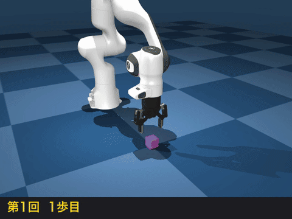
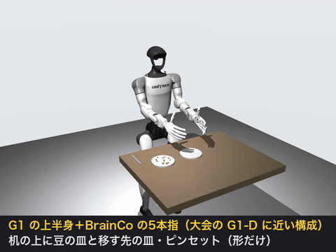
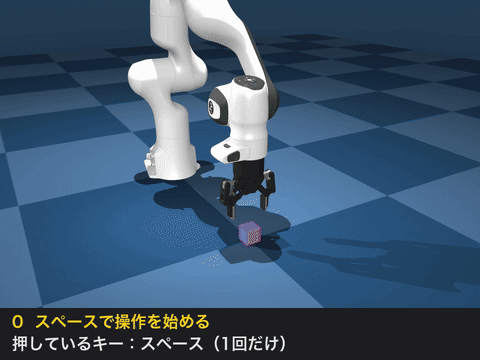
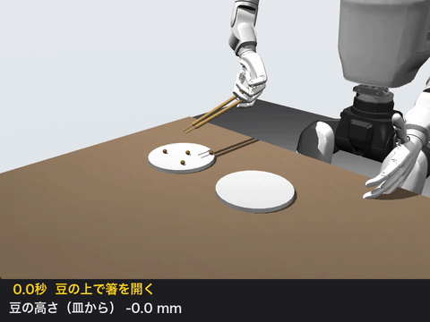
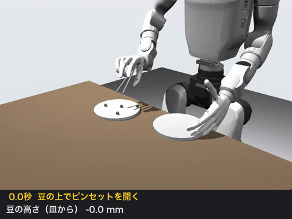
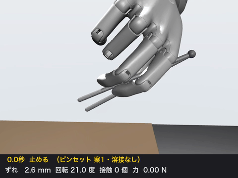
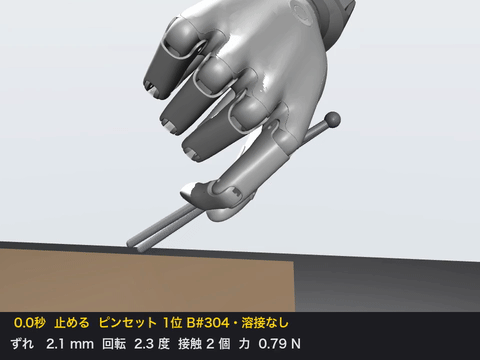

# GMOロボットハンドコンテスト 事前学習の記録

[第1回 GMOロボットハンドコンテスト](https://ai-robotics.gmo/lp/gmo-robot-hand-competition/)（5本指ハンドで炒り豆を5分間移す）に向けて、応募前の数日間に行った事前学習の記録です。

- 北京の世界大会にある同じ種目を調べました。
- 大会の機体 G1-D に近い「Unitree G1 ＋ BrainCo の5本指ハンド」をシミュレーターで動かしました。
- [LeRobot](https://github.com/huggingface/lerobot) の公式教材で「お手本 → 学習 → 評価」を一度回しました。

すべて MacBook Air（M5・32GB）上の MuJoCo シミュレーションで行い、実機は使っていません。

## 結果のまとめ

| 学習の段階 | 成功 | 様子 |
| --- | --- | --- |
| 2万歩 | 0 / 10 | まだつかめない |
| 4万歩 | **10 / 10** | 40歩でつかんで持ち上げる |
| 6万歩 | **10 / 10** | 成功 |
| 8万歩 | **10 / 10** | 成功（80歩） |
| 10万歩 | 0 / 10 | つかむが持ち上げない |

| 4万歩：下げる → つかむ → 持ち上げる | 10万歩：つかんだまま止まる |
| --- | --- |
|  |  |

最後まで学習した結果がいちばん良いとは限りませんでした。途中の段階も評価して選ぶ必要があります。

## 1. 北京で同じ種目がすでに行われていた

2026年8月の World Humanoid Robot Games（北京）に、5本指ハンドが「ピンセットで大豆をつまむ」種目（镊子夹豆 Tweezers Bean Picking）がありました。

| 項目 | 北京（WHRG 2026） | GMO 第1回 |
| --- | --- | --- |
| 課題 | ピンセットで大豆をつかむ・運ぶ・離す | 炒り豆を1粒ずつ皿から皿へ |
| 豆 | 直径 5mm の大豆 | 炒り豆（大きさの記載なし） |
| 制限時間 | 5分 | 5分 |
| 自律と遠隔操作 | 自律 ×1、遠隔操作 ×0.5 | 記載なし |
| 上位の結果 | 1位 全自律（OmniHand）、3位 遠隔操作で 71粒 | — |

優勝チームの粒数と具体的な手法は公開されていませんでした。

出典：[WHRG 2026 公式の種目一覧（PDF）](https://www.whrgoc.com/resources//uploads/20260822/1787382689139022892.pdf) ／ [Gasgoo](https://autonews.gasgoo.com/articles/news/opening-day-of-dexterous-hand-special-event-at-world-humanoid-robot-games-critical-point-wins-three-golds-2092584395855978497) ／ [中国経営報](https://news.qq.com/rain/a/20260826A0DKBB00) ／ [3位チームの記事](https://news.qq.com/rain/a/20260826A0BTNO00) ／ [新浪（制限時間）](https://news.sina.com.cn/c/2026-08-25/doc-inipnpyw9744459.shtml)

## 2. G1 ＋ BrainCo の5本指をシミュレーターで動かす

大会サイトに載っている機体は G1-D です。[GMO ヒューマノイド.shop](https://gmo-humanoid.shop/unitree/g1d/) で G1-D に付けられる5本指は BrainCo Revo 2 だけでした。そこで Unitree が公開している「G1 ＋ BrainCo の手」のモデルを MuJoCo で表示し、右手の6つの指令を一つずつ動かしました。



| 指令 | 動き |
| --- | --- |
| thumb_metacarpal | 親指が手のひらの方へ倒れる |
| thumb_proximal | 親指が曲がる |
| index / middle / ring / pinky _proximal | それぞれの指が曲がる |

指先の関節は根元に連動するので、関節の数（11）より指令の数（6）が少なくなっています。動画は関節の角度を直接入れて形を動かしたもので、物理の計算はしていません。ラボの実機に Revo 2 が付いているかは確認していません。

## 3. お手本から学ぶ流れを1周する

LeRobot の公式教材 [Imitation Learning in Sim](https://huggingface.co/docs/lerobot/main/en/il_sim) を使いました。ロボットアームがキューブをつかんで持ち上げる課題です。

1. **お手本**：同じ教材で公開されているお手本 [Kim-Ziho/il_gym_day1_v2](https://huggingface.co/datasets/Kim-Ziho/il_gym_day1_v2)（50回、すべて成功）を使いました。自分でキーボード操作して録る手順は、Mac ではアームが動かず断念しました。
2. **学習**：ACT という方式で、教材どおり 10万歩学習しました。Mac（M5・MPS）で1歩 約0.35秒、10万歩で約10時間でした。
3. **評価**：教材の評価プログラムは今の LeRobot（0.6.2）では動かなかったため、同じ内容（10回やらせて成功数を数える）を [il_sim/eval_act.py](il_sim/eval_act.py) で組み直しました。2万歩ごとに保存した段階をそれぞれ評価しています。

キー操作の意味を確かめるために作った見本（プログラムでキー操作と同じ動きをさせたもの）：



### 分かったこと

- 最後まで学習した結果（10万歩）は失敗し、途中の 4万〜8万歩は成功しました。途中の段階も評価する必要があります。
- 教材どおり「最初に100歩分の動きをまとめて決める」設定では、AI はずっと「何もしない」を出し続けました。「毎歩カメラを見て決め直す」設定（`n_action_steps=1`）に変えると、下げる・つかむまで進みました。上の表はこの設定での結果です。
- キューブの位置は毎回同じなので、10回の評価は実質同じ動きのくり返しです。位置を変えた評価はまだです。
- お手本はキーボード操作のため、ほとんどのコマが「何もしない」で、操作は一瞬だけでした。これが学習を難しくしていると考えています（推測）。

### 教材どおりでは動かなかったところ（LeRobot 0.6.2、2026年10月時点）

- 教材の設定見本 `env_config.json` の `gripper_penalty_in_reward` は今の版では使えず、外さないと起動しません。
- 爪を閉じるキーは右 Control でした。コード上の名前は open（開く）ですが、実際には爪が閉じました。MacBook の内蔵キーボードには右 Control がありません。
- `~/Documents` の下に置くと、仮想環境の `.pth` ファイルに Mac の隠しファイル印が付いて `No module named 'lerobot'` になりました。iCloud 同期の影響とみています（推測）。別の場所に置くと直りました。

## 4. 皿から皿へ運ぶ（箸・ピンセット）

10/14〜10/21 に、同じ G1 ＋ BrainCo の右手に箸とピンセットを持たせ、豆（球）を皿から皿へ運ぶところまでシミュレーターで試しました。ここからは物理の計算をしています。

道具は手のひらに固定（溶接）した仮の置き方です。指の形は見た目だけ合わせたもので、道具を支えているのは指ではありません（指で握る試験は次の節）。動きは手書きで、豆の位置を見て腕を合わせ続ける追従制御です。

| 箸（9mm の豆） | ピンセット（9mm の豆） |
| --- | --- |
|  |  |

時間割は、2秒ごろはさむ → 持ち上げる → 4.8〜6.4秒で隣の皿の真上へ運ぶ → 6.4〜7.0秒で下げる → 7.0〜7.5秒で開いて離す → 上げる、です。

| 豆の直径 | 箸 | ピンセット |
| --- | --- | --- |
| 20mm | 5 / 5 | 5 / 5 |
| 9mm | **5 / 5**（皿2の中心から 1mm） | **5 / 5**（皿2の中心から 1mm） |
| 5mm（北京の大豆と同じ） | 5 / 5 | 1 / 5 |

- 5回は豆の置き場所を ±2cm ずつ変えています（seed 2026）。追従制御なので、5回とも同じ動きになります。
- ピンセットは箸より短いので、移す先の皿を手の届く位置に寄せる必要がありました。
- ピンセットの 5mm は、4回とも腕2本が豆に一度も触れず、すれ違って交差しました。原因は切り分けていません。

動かすコマンド（動画は1回目だけ撮ります。上の GIF は横から撮った版）：

```bash
cd ~/Developer/gmo-hand/lerobot && TRANSFER=1 T_HOLD=3 BALL_MU=0.6 BEAN_D_MM=9 CAM_AZ=225 CAM_EL=-25 CAM_DIST=0.75 \
  .venv/bin/python <このリポジトリ>/sim/chop_transfer.py side 5 1   # 箸 → sim/chopsticks_transfer_9mm_side.mp4
cd ~/Developer/gmo-hand/lerobot && TRANSFER=1 T_HOLD=3 BALL_MU=0.6 BEAN_D_MM=9 CAM_AZ=225 CAM_EL=-25 CAM_DIST=0.75 \
  .venv/bin/python <このリポジトリ>/sim/tw_transfer.py side 5 1    # ピンセット → sim/tweezers_transfer_9mm_side.mp4
```

`BEAN_D_MM` を 20・5 に変えると、表の他の行になります。

## 5. 壁と対応

### 9mm の豆がつかめない → 先を細く・力を一定・接触の公式設定で 5回中5回

最初の箸（太さ 8mm）では、2cm は持てても 10mm・9mm は持ち上がりませんでした。3つを順に入れました。

| 変えたこと | 20mm | 14mm | 10mm | 9mm |
| --- | --- | --- | --- | --- |
| 箸の先 3cm を 8mm → 2.5mm に細くする | 5 / 5 | 0 / 5 | 0 / 5 | 0 / 5 |
| ＋ はさむ力を一定（0.3N）にする | 5 / 5 | 5 / 5 | 0 / 5 | 0 / 5 |
| ＋ 接触の設定を MuJoCo 公式のやり方に（solref 0.004・solimp 0.95/0.99・noslip 2・condim 4）、はさむ高さを豆の中心に | **5 / 5** | **5 / 5** | **5 / 5** | **5 / 5** |

細くしただけでは、軽い豆（9mm で 0.4g）に箸がめり込み、豆の上へ抜けていました。今のコードは3つとも入った状態です。

```bash
cd ~/Developer/gmo-hand/lerobot && BEAN_D_MM=9 .venv/bin/python <このリポジトリ>/sim/chop_small_track.py thin 5 1
```

### 豆が皿の上で転がり続ける → 転がり抵抗（condim 6）で止まる

皿2の上で離した 9mm の豆が止まらず、11秒の時点でも 13.1mm/s で転がり、皿2の中心から 45.9mm 離れていました（このままだと皿から出る計算）。豆の接触に転がり抵抗を入れる設定（condim 6）にすると、11秒の時点で中心から 1.0mm・速さ 0mm/s で止まりました（5回とも）。今のコードの既定は condim 6 です。

```bash
cd ~/Developer/gmo-hand/lerobot && TRANSFER=1 T_HOLD=3 BALL_MU=0.6 BEAN_D_MM=9 BALL_CONDIM=4 .venv/bin/python <このリポジトリ>/sim/chop_transfer.py condim4_hold3 5 1
cd ~/Developer/gmo-hand/lerobot && TRANSFER=1 T_HOLD=3 BALL_MU=0.6 BEAN_D_MM=9 BALL_CONDIM=6 .venv/bin/python <このリポジトリ>/sim/chop_transfer.py condim6_hold3 5 1
```

### 指だけでは持てない → 600通り試して残ったのは1つ

上の試験は道具を手に固定していました。固定をやめ、指の接触だけで道具を持てるかを試しました（学習なし）。持ち方は、人の持ち方の分類（Feix ほか 2016 の #20 ペン持ち・#21 箸の持ち方）に合わせて置いた形です。



- その持ち方のまま：ピンセット 0 / 5、箸 0 / 5。10回とも指が触れた直後（0.019〜0.029秒）に道具が回って抜けました。
- 持ち方の候補を 600通り作り、重力の下で落ちないものだけ残しました（1秒止める → 3秒まで止める → 手のひらを上下左右に10cm 動かす）。

| | 候補 | 1秒残った | 3秒残った | 腕を動かしても残った |
| --- | --- | --- | --- | --- |
| ピンセット | 600 | 7 | 4 | **1** |
| 箸 | 600 | 0 | 0 | **0** |



残った1つは、ペン持ちではなく、親指の先と人差し指の先の2点でつまむ形でした（2本の押す向き 176度＝ほぼ向かい合う）。ずれは最大 4.4mm・4.0度で、判定の 5mm・5度の手前でぎりぎり残りました。候補の作り方を広げた2回目は、ピンセットも 0 でした。

```bash
cd ~/Developer/gmo-hand/lerobot && TOOL=tweezers .venv/bin/python <このリポジトリ>/sim/grip_hold.py base 5 1
cd ~/Developer/gmo-hand/lerobot && TOOL=chopsticks .venv/bin/python <このリポジトリ>/sim/grip_hold.py base 5 1
cd ~/Developer/gmo-hand/lerobot && caffeinate -i .venv/bin/python <このリポジトリ>/sim/grasp_search.py tweezers 300
cd ~/Developer/gmo-hand/lerobot && caffeinate -i .venv/bin/python <このリポジトリ>/sim/grasp_search.py chopsticks 300
```

持ち方の案は `sim/grip_design.json`（`sim/grip_design.py` で作ったもの）から読みます。

## 6. ばらつき入りの見本で AI（ACT）を1周：10回中3回

箸で皿から皿へ運ぶ課題で、お手本 → 学習 → 評価をもう一度回しました。今回は毎回条件を変えています。

- **お手本**：追従制御で 50本（50本とも成功）。1本ごとに、豆の摩擦 0.3〜1.0・直径 8〜10mm・重さ ×0.7〜1.3・位置 ±2cm を乱数で変えました。3割の回は途中で豆を 1.5cm ずらし、立て直す動きを入れています。
- **AI に見せるもの**：腕7＋箸1の角度と、カメラ2台の画像（128px）。豆の位置は見せていません。
- **学習**：ACT（50手まとめて決め、16手ずつ実行）、1万歩。Mac で 61分。
- **評価**：お手本とは別の乱数で、条件を変えて10回。

| 学習の段階 | 移せた | 持ち上げた |
| --- | --- | --- |
| 2,500歩 | 0 / 10 | 0 / 10 |
| 5,000歩 | **3 / 10** | 3 / 10 |
| 7,500歩 | 1 / 10 | 1 / 10 |
| 10,000歩 | **3 / 10** | 5 / 10 |
| 10,000歩＋途中で豆を 1.5cm ずらす | 0 / 10 | 0 / 10 |

- 失敗はほぼ全部「はさむ」まででした。持ち上げた後に落としたのは 10,000歩の2回だけです。
- お手本に立て直しを入れても、AI は立て直しませんでした。
- 10回の評価は ±20〜30ポイントぶれます。数字は手順の練習として見ていて、本番の見込みにはしていません。
- 豆が 8〜10mm と小さく、128px の画像では数ピクセルにしか写らないことが原因の候補です（推測）。

```bash
cd ~/Developer/gmo-hand/lerobot && .venv/bin/python <このリポジトリ>/sim/chop_collect_rand.py 50
cd ~/Developer/gmo-hand/lerobot && caffeinate -i .venv/bin/lerobot-train --dataset.repo_id=tanuma/chop_rand9 --policy.type=act \
  --policy.chunk_size=50 --policy.n_action_steps=16 --policy.device=mps --policy.push_to_hub=false \
  --steps=10000 --save_freq=2500 --batch_size=8 --num_workers=4 --log_freq=500 --seed=1000 \
  --output_dir=../outputs/train/chop_rand9 --job_name=chop_rand9 --wandb.enable=false
cd ~/Developer/gmo-hand/lerobot && caffeinate -i .venv/bin/python <このリポジトリ>/sim/chop_eval_rand.py ../outputs/train/chop_rand9/checkpoints/010000/pretrained_model 10 16
cd ~/Developer/gmo-hand/lerobot && caffeinate -i .venv/bin/python <このリポジトリ>/sim/chop_eval_rand.py ../outputs/train/chop_rand9/checkpoints/010000/pretrained_model 10 16 1.0,0.015,0
```

お手本は `~/.cache/huggingface/lerobot/tanuma/chop_rand9` に作ります（同じ場所に前のお手本があると消してから作り直します）。Hub には上げません。

## 7. これから

シミュレーターの中の Revo 2 では、指の形と硬さだけで道具を握ることはできませんでした（箸は 0、ピンセットはかろうじて1つ）。そこで次の形を本命として考えています。

- 指は開閉だけに使う。
- 道具は手に固定する（固定してよいかは大会側に確かめる）。
- 豆の位置合わせは腕で動かして行う。

12月に実機で、Revo 2 が箸・ピンセットを握って保てるかを最初に確かめます（本物の指先はゴムでたわむので、シミュレーターとは違う可能性があります。推測）。

## 次にやること（開発期間に入ったら）

- まず遠隔操作で豆を運べるようにする。点数の保険になり、その操作の記録がそのまま自律の AI のお手本になります。
- 同じお手本で自律の AI を学習させ、5分で何粒運べるかを遠隔操作と並べて比べ、本番の方式を数字で決めます。
- ピンセットの持ち方とカメラの位置を早めに固めます（北京の3位チームは持ち方を変えて 33粒 → 71粒）。
- 実機での流れは Unitree 公式の [xr_teleoperate](https://github.com/unitreerobotics/xr_teleoperate)（遠隔操作で録る）と [unitree_lerobot](https://github.com/unitreerobotics/unitree_lerobot)（学習）を想定しています。

## 再現手順

LeRobot（0.6.2）を Python 3.12 で入れます（`~/Documents` の外に置く）。

```bash
git clone https://github.com/huggingface/lerobot.git
cd lerobot
uv venv --python 3.12
uv pip install -e ".[hilserl,training]"
```

学習（教材どおり。Mac では `--policy.device=mps`）：

```bash
.venv/bin/lerobot-train --dataset.repo_id=Kim-Ziho/il_gym_day1_v2 --policy.type=act \
  --output_dir=outputs/train/il_sim_test --job_name=il_sim_test \
  --policy.device=mps --policy.push_to_hub=false --wandb.enable=false
```

評価（学習結果のパス・回数・何歩ごとに見直すか）：

```bash
.venv/bin/python <このリポジトリ>/il_sim/eval_act.py outputs/train/il_sim_test/checkpoints/040000/pretrained_model 10 1
```

G1 の動画は、Unitree の [unitree_ros](https://github.com/unitreerobotics/unitree_ros) から `robots/g1_with_brainco_hand` を `sim/unitree_ros/` に取ってきてから、`python sim/g1_demo_video.py` で作れます（mujoco 3.15 で確認）。

4〜6節のファイルも同じ `sim/unitree_ros/` を使います。`sim/` のファイルは互いに読み込み合うので、同じフォルダに置いたまま動かしてください（場所はファイル自身の位置から決めるので、パスの書き換えは要りません）。動画・CSV・画像は `sim/` に書き出されます。上のコマンドの `~/Developer/gmo-hand/lerobot` は、LeRobot を入れた場所に読み替えてください。

## ファイル

| パス | 中身 |
| --- | --- |
| `il_sim/env_config.json` | 教材の設定見本を今の版に合わせたもの |
| `il_sim/eval_act.py` | 評価（10回・成功数・動画） |
| `il_sim/demo_keys_video.py` | キー操作の見本動画を作る |
| `il_sim/results/` | 評価の記録 |
| `sim/g1_demo_video.py` | G1 ＋ BrainCo の右手を動かす動画を作る（ほかの sim/*.py が場面の土台に使う。10/14 に皿をピンセットの手が届く位置へ寄せたので、上の GIF とは皿の位置が違います） |
| `sim/chopsticks_look.py` ・ `sim/tweezers_look.py` | 箸・ピンセットを手に持たせた静止画（物理なし）。持たせ方の値をほかのファイルが使う |
| `sim/chopsticks_pick.py` ・ `sim/tweezers_pick.py` | 箸・ピンセットで豆をつまむ・移す本体（物理あり。条件は環境変数で変える） |
| `sim/chop_small_track.py` | 箸で小さい豆をつまむ試験を5回まとめて走らせる |
| `sim/chop_transfer.py` ・ `sim/tw_transfer.py` | 皿から皿へ移す試験を5回まとめて走らせる（箸・ピンセット） |
| `sim/grip_design.py` ・ `sim/grip_design.json` | 人の持ち方に合わせた持ち方の案を作る・その値 |
| `sim/grip_hold.py` | 道具を固定せず指だけで持てるかを試す |
| `sim/grasp_search.py` | 持ち方の候補を 600通り作り、物理で落ちないものを残す |
| `sim/chop_collect_rand.py` ・ `sim/chop_eval_rand.py` | ばらつき入りのお手本を集める・学習した ACT を評価する |
| `media/` | README の動画（GIF） |

## 使ったもの

- [LeRobot](https://github.com/huggingface/lerobot)（Apache-2.0）と gym-hil
- お手本 [Kim-Ziho/il_gym_day1_v2](https://huggingface.co/datasets/Kim-Ziho/il_gym_day1_v2)（Apache-2.0）
- [unitree_ros](https://github.com/unitreerobotics/unitree_ros) の G1 ＋ BrainCo モデル（BSD-3-Clause）
- [MuJoCo](https://github.com/google-deepmind/mujoco)

このリポジトリのコードは MIT ライセンスです。

## 参考資料（reports/）

- [録る → 学習 → 測る 手順書（シミュ版）](reports/act-sim-procedure-2026-10-16.md)：見本集め・学習・評価のコマンドとかかった時間。12月に実機で同じ流れを回すときの下敷き
- [5本指ハンドで道具を握らせる先行例の調べ](reports/how-world-grasps-tools-2026-10-21.md)：箸・ピンセットを指で保持した研究の作り方・学習時間・成功率（出典つき）

## 発表資料

- [GMOロボットハンド 1分報告（PDF）](<slides/GMOロボットハンド 1分報告.pdf>)：BootCamp での1分報告（2026-10-22）
